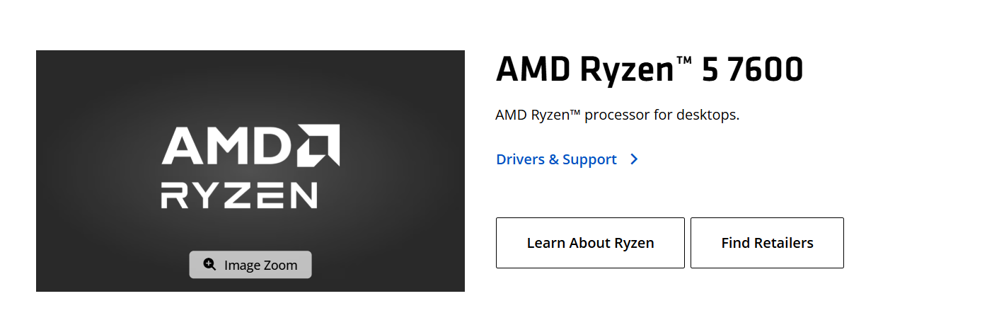
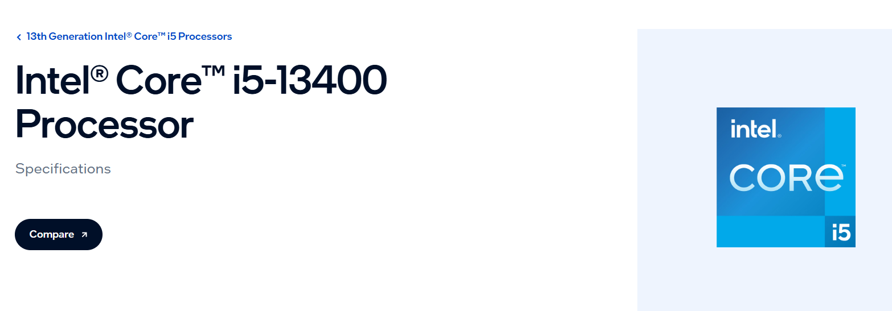
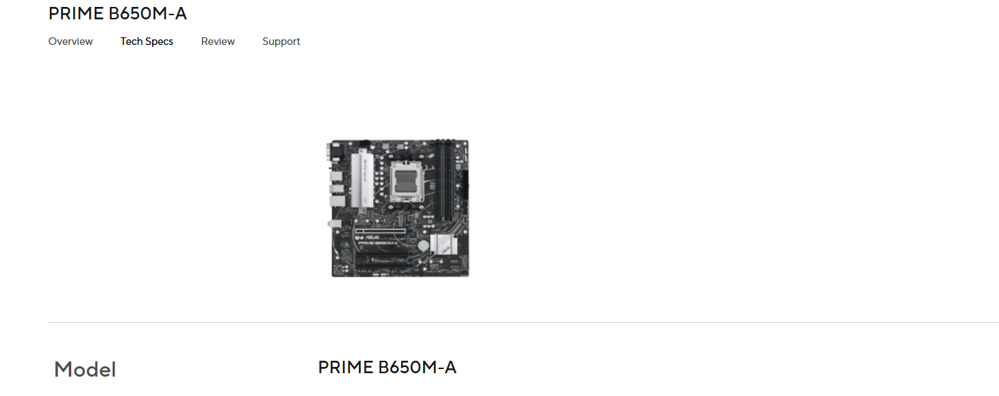
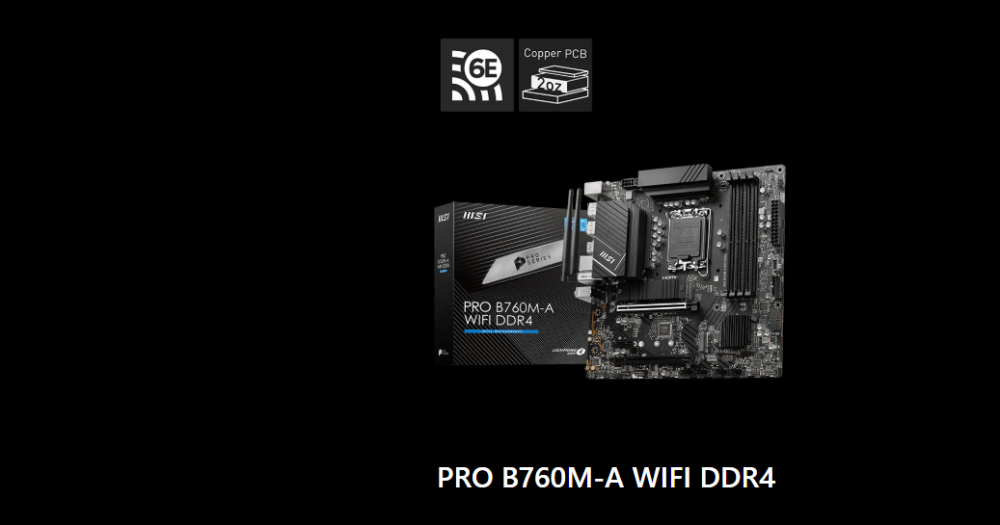
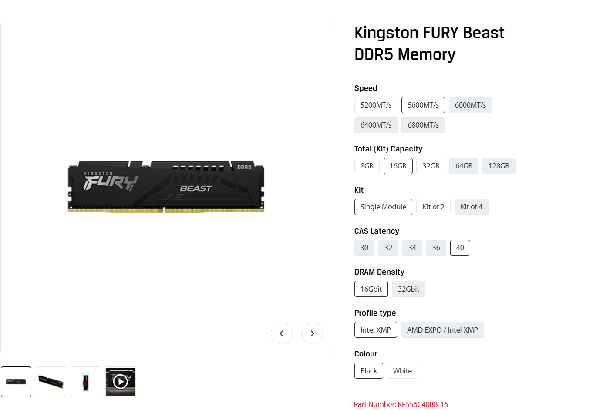
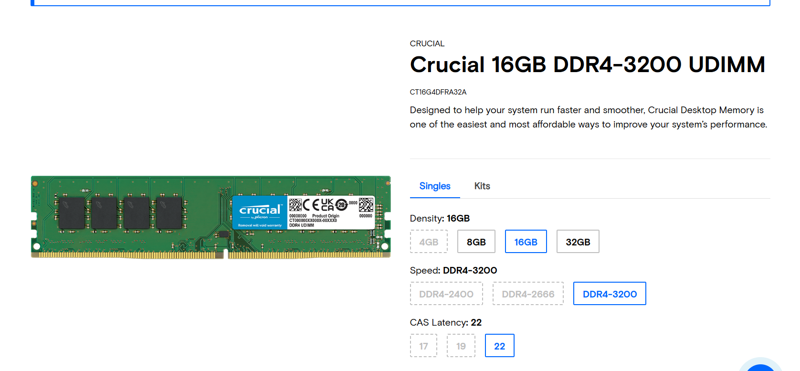
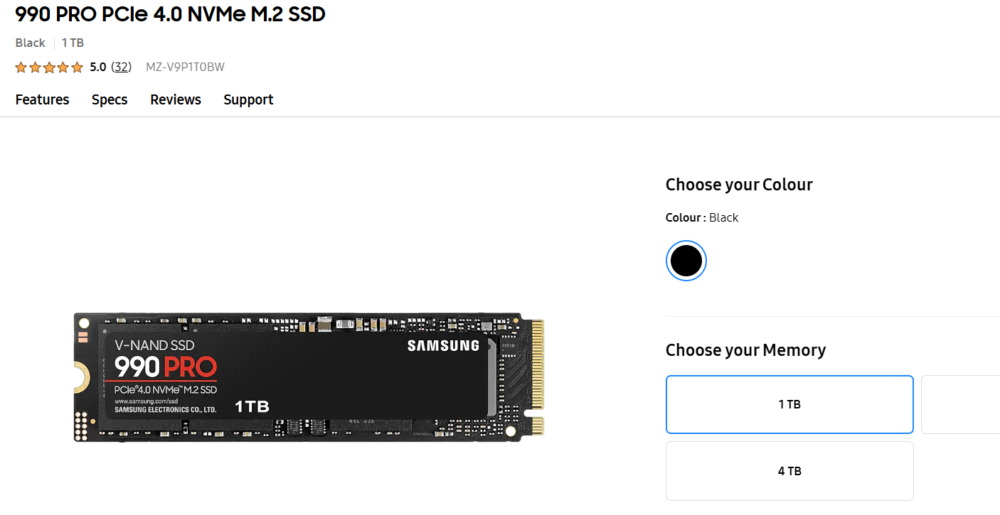
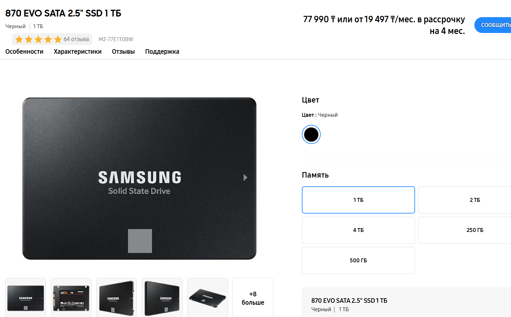
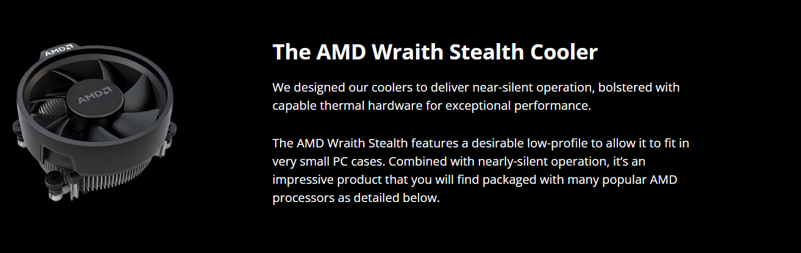

# Lab 3 — Teardown, and the same machine from the command line

Pair: <name> + <name> · Date: <date>

## Part 1 — Ten parts

### AMD Ryzen 5 7600

6-core/12-thread desktop processor, 3.8 GHz base clock, 65W TDP, supports PCIe 5.0 and DDR5. Connects to: Motherboard socket AM5. Limit: Fits only AM5 motherboards and strictly requires DDR5 memory; cannot be used with DDR4. — Source: https://www.amd.com/en/products/processors/desktops/ryzen/7000-series/amd-ryzen-5-7600.html

### Intel Core i5-13400

10-core (6 P-cores + 4 E-cores)/16-thread desktop processor, 65W base power, supports PCIe 5.0. Connects to: Motherboard socket LGA1700. Limit: Fits only LGA1700 motherboards; supports both DDR4 and DDR5, but memory type is strictly limited by the specific motherboard chipset. — Source: https://www.intel.com/content/www/us/en/products/sku/230495/intel-core-i513400-processor-20m-cache-up-to-4-60-ghz/specifications.html

### ASUS PRIME B650M-A

Micro-ATX motherboard. Chipset: AMD B650. CPU Support: AMD Ryzen 7000, 8000, and 9000 Series (AM5 socket). Connects to: AM5 processors, ATX 24-pin power, 8-pin CPU power. Storage: 2x M.2 slots (PCIe 5.0/4.0), 4x SATA 6Gb/s ports. Limit: Only accepts AM5 processors and requires DDR5 memory (4x slots); physically incompatible with DDR4 and older AM4 CPUs. — Source: https://www.asus.com/motherboards-components/motherboards/prime/prime-b650m-a/

### MSI PRO B760M-A WIFI DDR4

Micro-ATX motherboard. Chipset: Intel B760. CPU Support: Intel Core 12th, 13th, and 14th Gen processors (LGA1700 socket). Connects to: LGA1700 processors, ATX 24-pin power, 8-pin + 4-pin CPU power. Storage: 2x M.2 slots (PCIe 4.0), 4x SATA 6Gb/s ports. Limit: Only accepts LGA1700 processors and requires DDR4 memory (4x slots); the physical slots block DDR5 installation. — Source: https://ru.msi.com/Motherboard/PRO-B760M-A-WIFI-DDR4/Specification

### Kingston FURY Beast DDR5-5600, 16 GB

DDR5 UDIMM memory module, 16 GB capacity, 5600 MT/s speed. Connects to: DDR5 DIMM slots on a compatible motherboard, one per memory channel. Limit: Fits only motherboards explicitly designed for DDR5; the physical notch makes inserting it into a DDR4 slot impossible. — Source: https://www.kingston.com/en/memory/gaming/kingston-fury-beast-ddr5-memory

### Crucial DDR4-3200, 16 GB DIMM

DDR4 UDIMM memory module, 16 GB capacity, 3200 MT/s speed. Connects to: DDR4 DIMM slots on a compatible motherboard, one per memory channel. Limit: Fits only motherboards explicitly designed for DDR4; cannot be used in newer DDR5 motherboards. — Source: https://www.crucial.com/memory/ddr4/ct16g4dfra32a

### Samsung 990 PRO 1 TB

NVMe PCIe 4.0 SSD, M.2 2280 form factor, 1 TB capacity, speeds up to 7450 MB/s. Connects to: An M.2 slot on a motherboard supporting PCIe 4.0 x4. Limit: Requires an M.2 slot with NVMe (PCIe) support; it will not work in M.2 slots wired exclusively for SATA, and installing it in a PCIe 3.0 slot will halve its maximum speed. — Source: [https://www.samsung.com/us/computing/memory-storage/solid-state-drives/990-pro-pcie-4-0-nvme-ssd-1tb-mz-v9p1t0b-am/](https://www.samsung.com/uk/memory-storage/nvme-ssd/990-pro-1tb-nvme-pcie-gen-4-mz-v9p1t0bw/) 

### Samsung 870 EVO 1 TB

SATA III SSD, 2.5-inch form factor, 1 TB capacity, speeds up to 560 MB/s. Connects to: A SATA port on the motherboard (via data cable) and a SATA power connector from the power supply. Limit: Performance is strictly bottlenecked by the SATA III interface (limit ~560 MB/s); requires physical mounting space and two cables, unlike an M.2 drive. — Source: https://www.samsung.com/kz_ru/memory-storage/sata-ssd/870-evo-1tb-sata-3-2-5-ssd-mz-77e1t0bw/

### Corsair RM750e (750 W)
.png)
Fully modular ATX power supply, 750W capacity, 80 PLUS Gold efficiency. Connects to: The motherboard (24-pin and CPU 8-pin), storage drives (SATA power), and graphics card (PCIe power). Limit: The total peak power draw of all connected components must not exceed 750 watts; requires standard ATX chassis clearance. — Source: https://www.corsair.com/ww/en/p/psu/cp-9020248-ww/rme-series-rm750e-fully-modular-low-noise-atx-power-supply-cp-9020248-ww

### AMD Wraith Stealth Cooler

Low-profile CPU air cooler. Connects to: AMD AM4/AM5 motherboard socket mounts and a 4-pin CPU_FAN header for power. Limit: Fits only AMD sockets (mechanically incompatible with Intel sockets); its thermal capacity is strictly designed for 65W TDP processors. — Source: https://www.amd.com/en/products/processors/ecosystem/cpu-cooler-solutions.html

## Two builds
### Build 1
| Part | Model | Why it fits here |
|------|--------|----------|
| Processor | AMD Ryzen 5 7600 | It physically fits into the AM5 socket on the ASUS motherboard. |
| Motherboard | ASUS PRIME B650M-A | It provides the AM5 socket for the Ryzen processor and DDR5 slots for the memory. | 
| Memory | Kingston FURY Beast DDR5-5600, 16 GB | This is DDR5 memory, which the Ryzen 7000 series requires and the ASUS motherboard supports. |
| Cooler | AMD Wraith Stealth Cooler | It is mechanically compatible with the AM5 socket mounts on the ASUS board and handles the CPU's 65W heat output. | 
| SSD | Samsung 990 PRO 1 TB | It plugs directly into an available M.2 (PCIe 4.0/5.0) slot on the ASUS motherboard. |

What each build still needs: A power supply unit (ATX), a computer case, a monitor, a keyboard, and a mouse. A dedicated graphics card is not strictly required because the CPU has built-in graphics.

### Build 2
| Part | Model | Why it fits here |
|------|--------|----------|
| Processor | Intel Core i5-13400 | It physically fits into the LGA1700 socket on the MSI motherboard. |
| Motherboard | MSI PRO B760M-A WIFI DDR4 | It provides the LGA1700 socket for the Intel CPU and has DDR4 memory slots, making it incompatible with Build 1's parts. | 
| Memory | Crucial DDR4-3200, 16 GB DIMM | The MSI motherboard specifically requires DDR4 memory and only has DDR4 slots. |
| SSD | Samsung 870 EVO 1 TB | It connects via a SATA cable to one of the SATA 6Gb/s ports on the MSI motherboard. | 
| Power Supply | Corsair RM750e (750 W) | It provides the 24-pin and 8-pin power for the MSI motherboard, plus the SATA power cable needed for the Samsung 870 EVO SSD. |

What this build still needs : A CPU cooler (compatible with the LGA1700 socket), a computer case, a monitor, a keyboard, and a mouse. A dedicated graphics card is not strictly required because the Intel CPU has built-in graphics.

## Part 2 — Same facts, two operating systems
| Fact | Windows (PowerShell) | Linux | macOS |
|---|---|---|---|
| CPU model | `Get-CimInstance Win32_Processor \| Select Name` | `lscpu` | |
| Cores / threads | `Get-CimInstance Win32_Processor \| Select NumberOfCores, NumberOfLogicalProcessors` | `lscpu` | |
| Total memory | `Get-CimInstance Win32_PhysicalMemory \| Select Capacity` | `free -h` | |
| Memory modules and speed | `Get-CimInstance Win32_PhysicalMemory \| Select DeviceLocator, Speed` | `sudo dmidecode -t memory` | |
| Disk model and type | `Get-PhysicalDisk \| Select FriendlyName, MediaType, BusType` | `lsblk -d -o NAME,MODEL,ROTA,TRAN,SIZE` | |
| Free space | `Get-Volume C` | `df -h /` | |
| Architecture (x86-64 / ARM64) | `$env:PROCESSOR_ARCHITECTURE` | `uname -m` | |

Windows uses PowerShell objects to check hardware, while Linux uses separate command-line tools. The hypervisor hides the real hardware, so the Ubuntu VM only sees the virtualized parts you gave it. Because of this, the VM shows a virtual disk (like "VMware Virtual") and cannot see the real physical RAM modules or memory speed.

## What did not work the first time
what you saw: I could not copy the output of the commands onmy Ubuntu st step 5.  what it was: It can be explained by the fact that VMware tools were missing. what you did: I used PowerShell on my host machine in order to connect to my ubuntu. Then, I run all the commands there and successfully gained the outputs.

## Evidence
- evidence/windows-specs.txt — …
- evidence/linux-specs.txt — …
