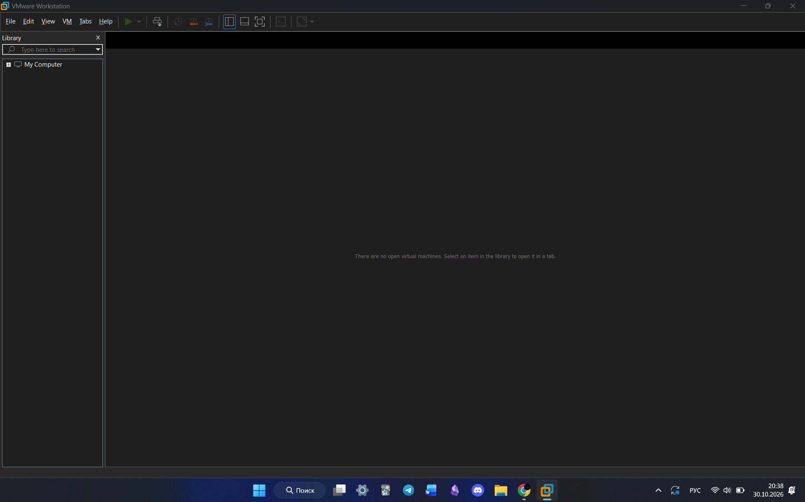
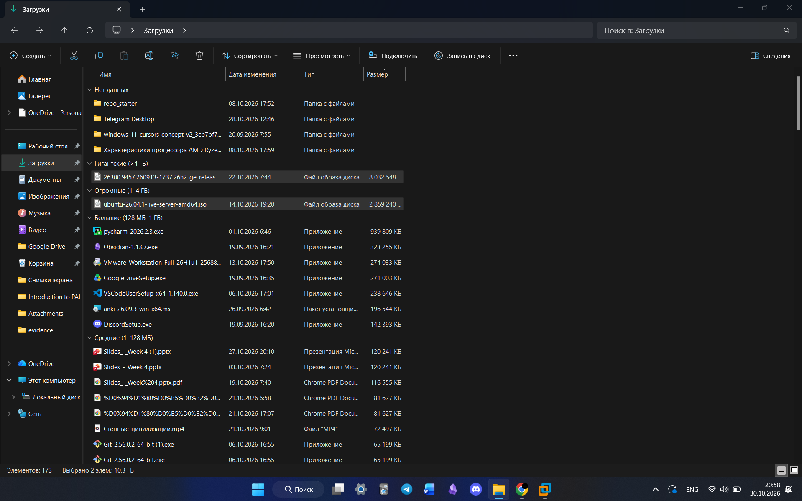
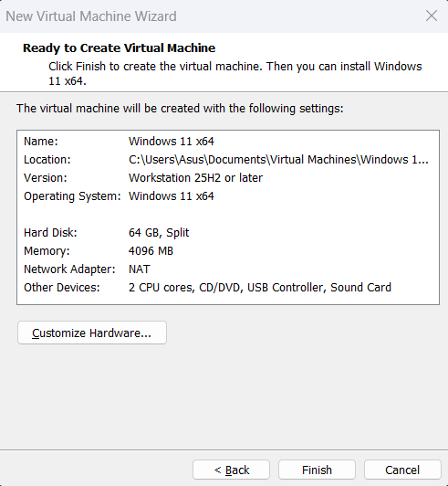
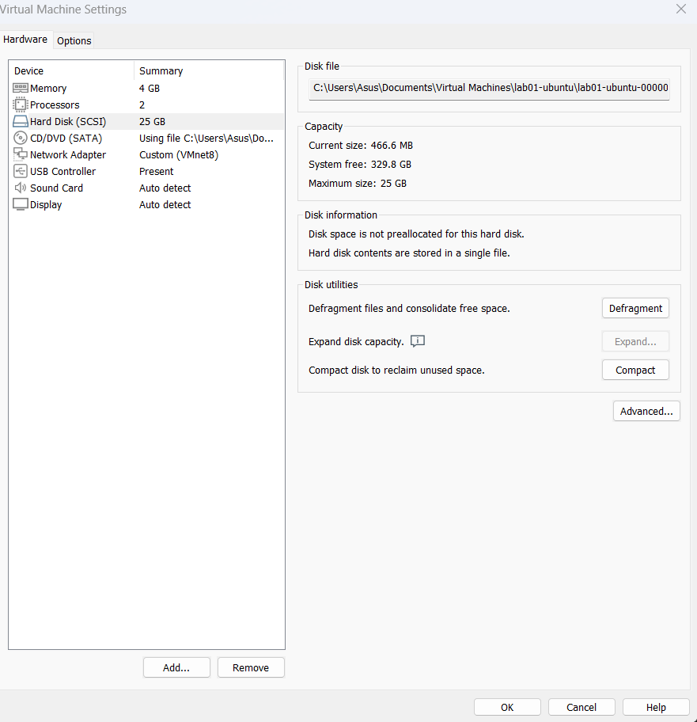
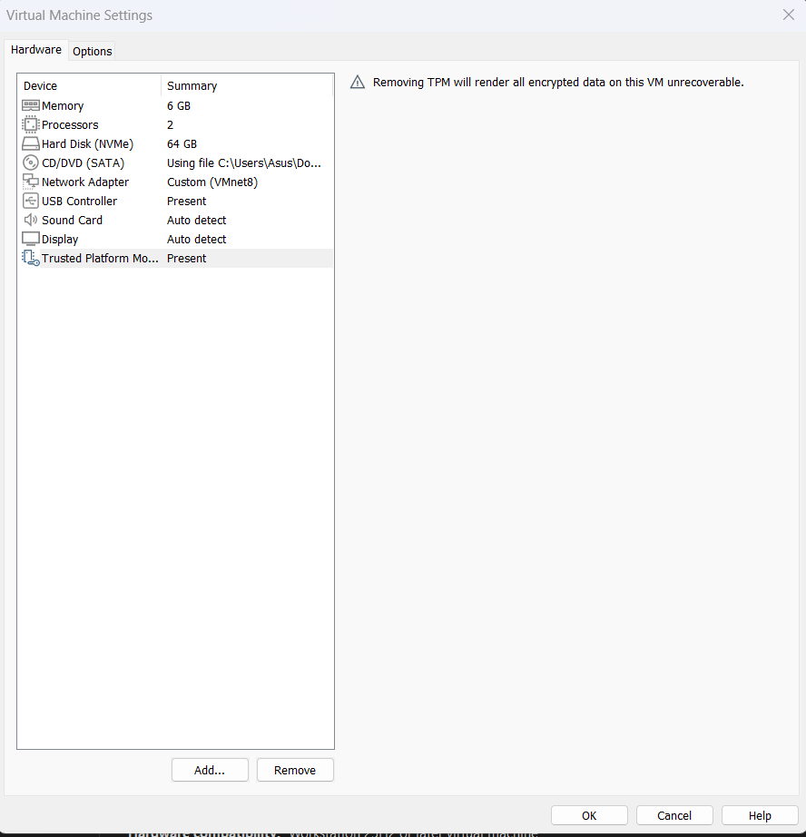
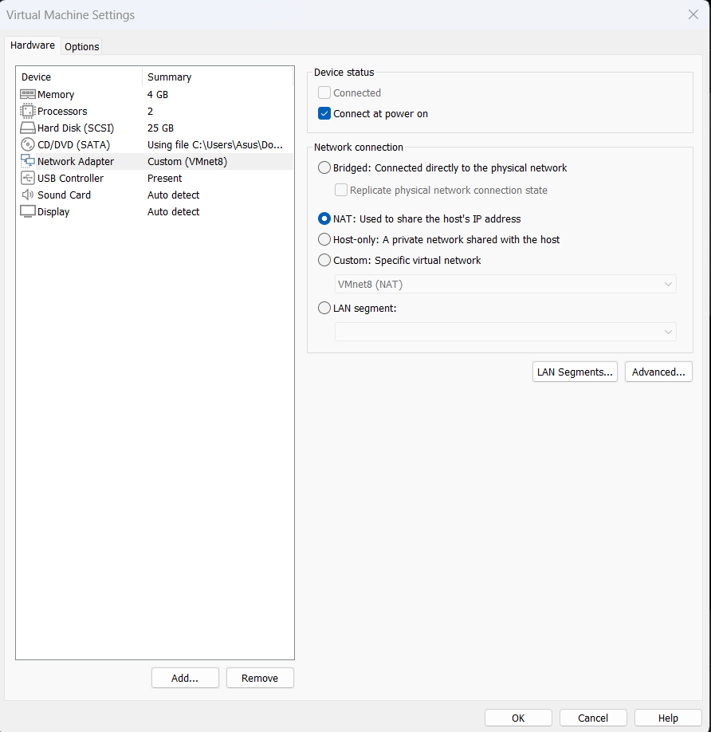
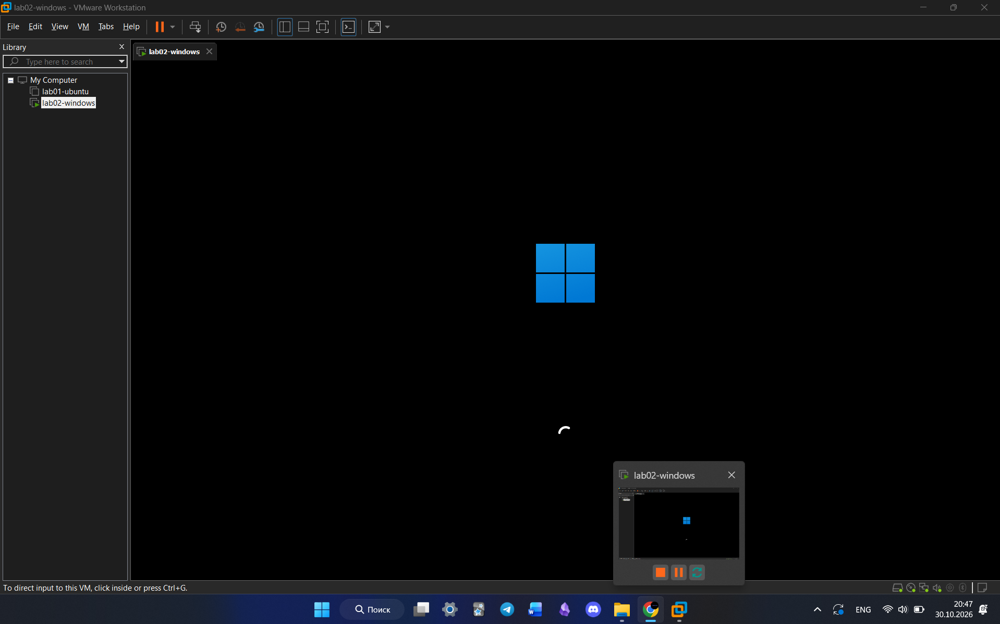
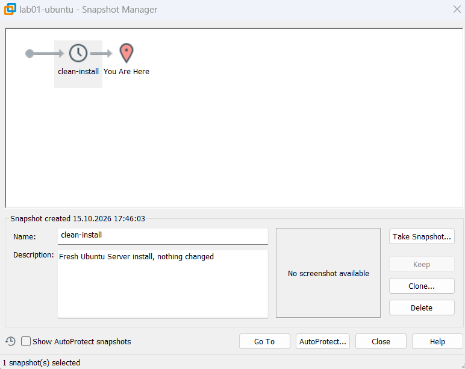
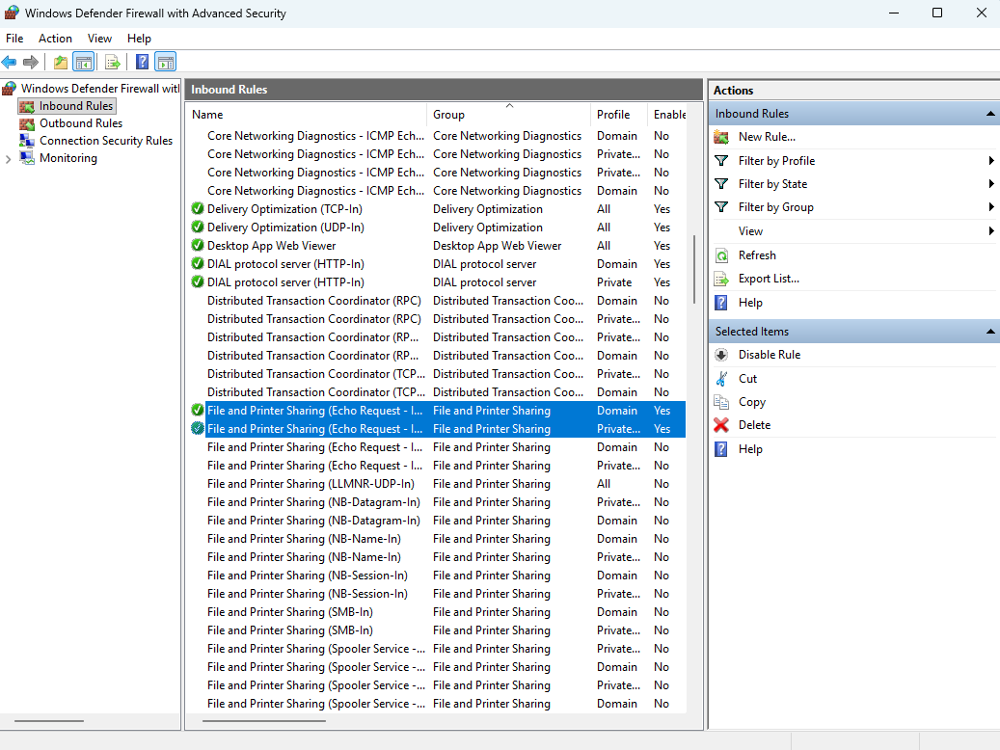

# VM Build Guide for Test Environment

This guide explains how to set up isolated test virtual machines (VMs) using VMware Workstation Pro. Follow these steps sequentially to create a safe testing environment.

## Step 1. Installing the Hypervisor
Download and install VMware Workstation Pro from the official Broadcom/VMware website. 

**Why VMware Workstation Pro:** It provides advanced virtualization features, supports TPM (required for Windows 11), and is currently available for free for personal/evaluation use, which avoids accidental licensing costs for the office.
> Check: Open VMware Workstation Pro. The home screen should load without requesting a paid license key.

## Step 2. Downloading Operating System ISOs
Download the **Ubuntu Server LTS** and **Windows 11 Enterprise Evaluation** ISO files from their official websites.

**Why evaluation versions:** The Windows 11 Enterprise Evaluation is free and legal for 90 days, which is perfect for a temporary test machine. We use Ubuntu Server (no graphical interface) because it consumes fewer resources and is standard for development environments.
> Check: Verify that both files end in `.iso` and are fully downloaded to your local drive.

## Step 3. Creating the Virtual Machines (Resources)
Open VMware Workstation, click "Create a New Virtual Machine," and allocate CPU and Memory for both guests.

**Why these resources:** I allocated 2 vCPUs and 4 GB of RAM for Windows, and 1 vCPU and 2 GB of RAM for Ubuntu. This leaves enough memory for the host machine to run smoothly without crashing, while providing enough power for basic testing.
> Check: In the VM details page, verify the "Memory" and "Processors" match your assigned numbers.

## Step 4. Disk Configuration
When creating the virtual disks, select "Dynamically allocated" (or "Split virtual disk into multiple files" in VMware, ensuring it is not pre-allocated).

**Why thin provisioning:** A dynamically allocated disk only takes up space on your physical hard drive as it fills up. This saves storage space on your laptop compared to allocating the full 50 GB immediately.
> Check: Check the VM folder on your physical drive; the `.vmdk` file should be just a few megabytes initially, not the full gigabyte size.

## Step 5. Windows 11 Specific Settings (TPM & Firmware)
For the Windows 11 VM, go to Settings > Options > Access Control, encrypt the VM, and add a Trusted Platform Module (TPM) hardware under the "Hardware" tab. Ensure the firmware is set to UEFI.

**Why this step is needed:** Windows 11 strictly requires a TPM 2.0 chip and UEFI firmware to install. Without encrypting the VM first in VMware Workstation, the option to add a virtual TPM will be greyed out.
> Check: Boot the Windows 11 VM; it should bypass the "This PC can't run Windows 11" error during setup.

## Step 6. Networking
In both VMs' settings, under Network Adapter, choose **NAT**.

**Why NAT and not Bridged:** Office and campus networks often filter by MAC address and will drop connections from a Bridged guest[cite: 22]. With NAT, the VMs share the host's IP address and MAC address, bypassing network filters while still allowing the VMs to reach the internet and each other[cite: 22].
> Check: Run `ip addr` in Ubuntu or `ipconfig` in Windows. You should see an internal IP address (like 192.168.x.x) assigned by VMware.

## Step 7. Installing the Operating Systems
Start both VMs and complete the installation prompts (create a user, set a password). 

**Why default settings:** For a basic test environment, the default installation parameters for both Ubuntu and Windows are sufficient. We do not need custom partitions at this stage.
> Check: You should be able to reach the desktop on Windows 11 and the command prompt on Ubuntu Server.

## Step 8. Taking a Clean Snapshot
Before the new developer uses the machines, go to VM > Snapshot > Take Snapshot. Name it `clean-install`.

**Why take a snapshot:** The developer needs to test things "without breaking anything". If they ruin the system, you can instantly revert to this exact working state by clicking "Revert to Snapshot", saving you hours of reinstalling.
> Check: Open the Snapshot Manager in VMware. You should see "clean-install" listed above the "You are here" marker.

## Step 9. Troubleshooting a Typical Error
**Problem:** The VMs cannot ping each other, even though they are both on NAT.

**Why this happens:** By default, the Windows Defender Firewall blocks incoming ICMP (ping) requests. 
**How to fix:** Do not turn off the firewall. Instead, open "Windows Defender Firewall with Advanced Security" in the Windows guest, go to Inbound Rules, and enable "File and Printer Sharing (Echo Request - ICMPv4-In)". 
> Check: Run `ping <Windows-IP>` from the Ubuntu machine. It should now return replies instead of timing out.
